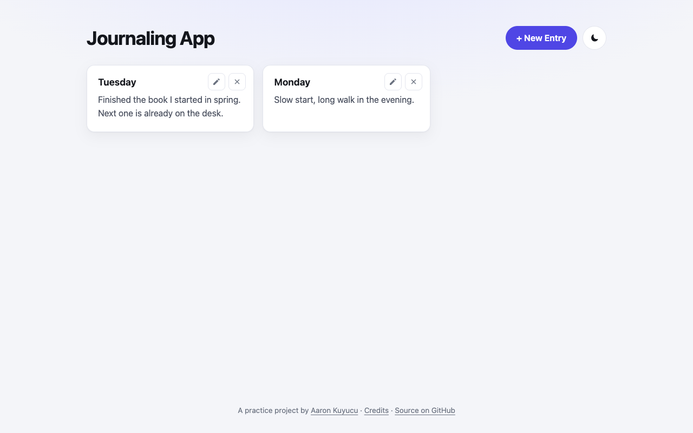

# Journaling

A journal in the browser: write, edit and delete entries, stored locally, with a light and dark theme.



## Features

- Create, edit and delete entries in a modal dialog (`<dialog>`)
- Entries persist in `localStorage`
- Dark mode toggle that remembers the choice
- Empty state with a call to action

## Tech

- HTML (Dialog API), CSS custom properties, vanilla JavaScript
- `localStorage` for persistence

## How to run

Open the live version: **[aaronkuy.github.io/journaling](https://aaronkuy.github.io/journaling/)**

Or run it locally. There is no build step and no dependency:

```bash
git clone https://github.com/aaronkuy/journaling.git
cd journaling
open index.html        # macOS; on Linux use xdg-open, on Windows start
```

## Credits

This project started from a tutorial for a notes app built with HTML, CSS and JavaScript on top of `localStorage`. The program flow of `index.js` (one array of entries, one dialog for both creating and editing, a theme toggle) follows that tutorial, with "notes" renamed to "entries". The stylesheet was replaced with a new design in October 2026.

## What I'd do next

- Escape user text before rendering it (or build cards with DOM methods)
- Dates on entries and a search field
- Export and import as JSON

## License

MIT, see [LICENSE](LICENSE). The copyright notice refers to the changes made in this repository, not to the tutorial code the app started from (see [Credits](#credits)).
