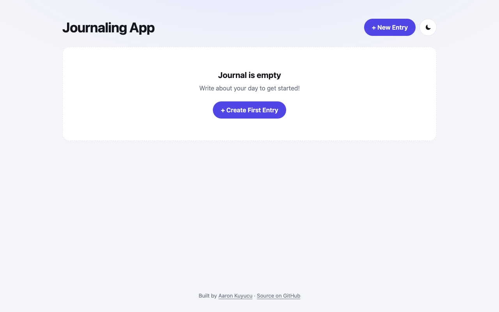

# Journaling

A journal in the browser: write, edit and delete entries, stored locally, with a light and dark theme.



## Features

- Create, edit and delete entries in a modal dialog (`<dialog>`)
- Entries persist in `localStorage`
- Dark mode toggle that remembers the choice
- Empty state with a call to action

## Tech

- HTML (Dialog API), CSS custom properties, vanilla JavaScript
- `localStorage` for persistence

## How to run

Open the live version: **[aaronkuy.github.io/journaling](https://aaronkuy.github.io/journaling/)**

Or run it locally. There is no build step and no dependency:

```bash
git clone https://github.com/aaronkuy/journaling.git
cd journaling
open index.html        # macOS; on Linux use xdg-open, on Windows start
```

## What I learned

- Managing an array of objects with IDs, `map`, `filter`, `findIndex` and the spread operator
- Switching one form between "create" and "edit" mode with a single state variable
- Saving and restoring state across reloads

## What I'd do next

- Escape user text before rendering it (or build cards with DOM methods)
- Dates on entries and a search field
- Export and import as JSON

## License

See [LICENSE](LICENSE).
